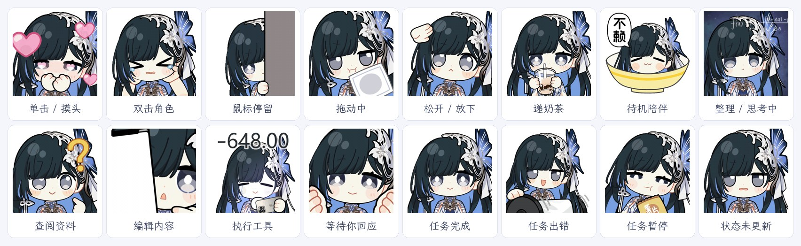

<!-- README language switch -->
 

**v1.0.1**: Each expression now lasts until its voice line ends, with fixed rules for interacting while she speaks; the settings window shows every preview when it opens. Two skins (bridal / original) with 128 expressions, and 115 Selena voice lines set up for 16 interactions. The full package includes a one-click deploy script that also installs the Harness connection plugin; later versions update from inside the pet.

<!-- /README language switch -->

# Selena DeepSeek Desktop Pet

**Selena from *Punishing: Gray Raven* keeps you company in DeepSeek Harness: her expression follows your tasks, and she answers in her own voice.**

[Download for Windows](https://github.com/Doya16/selena-deepseek-pet/releases/latest) · [User guide (Chinese)](docs/USAGE.md) · [Report an issue](https://github.com/Doya16/selena-deepseek-pet/issues)

For the official **DeepSeek Harness Windows client**, on **Windows 10/11 x64**. The full package includes two skins with 128 GIFs, 115 Selena voice lines with subtitles, fonts and the Harness connection plugin; no Python installation is required. A [Codex edition](https://github.com/Doya16/selena-codex-pet) is also available; both can run together.

## Download and one-click deploy

1. Install the official **DeepSeek Harness** and sign in once.
2. Download **Selena-DeepSeek-Windows-v1.0.1.zip** from [Releases](https://github.com/Doya16/selena-deepseek-pet/releases/latest).
3. **Extract the whole ZIP** into a writable folder, for example `D:\Selena`.
4. Double-click **一键部署.cmd** (one-click deploy). It checks the package, asks you to fully quit Harness from the tray (your login is kept), installs the Harness connection plugin, creates desktop and Start menu shortcuts and starts Selena.
5. Reopen Harness and start a task; the pet follows the most recent conversation.

If you would rather not quit Harness now, type `S` at the prompt to skip the plugin and run the script again later, or use **Settings → Connect DeepSeek → Install / update the Harness connection plugin**. No API key is needed.

## Two skins

Switch in **Settings → Desktop & Sound → Default expression style**:

- **Bridal** (default): every interaction has its own bridal expression.
- **Original**: the original-outfit sticker set; interactions without a same-named sticker use the closest one.

## One-click updates

The pet checks for new versions in the background (every 6 hours by default). Click **更新并重启赛琳娜** (update and restart Selena) on the notice to download, verify, install and restart. Only program files are downloaded; your GIFs, voices, subtitles, fonts and settings stay. Update manifests are signed with the publisher's offline Ed25519 key; an interrupted install rolls back.

## Features

- Task states (thinking, reading, editing, running tools, waiting for you, done, error, paused) with their own expressions; separate completion notices per conversation.
- Mouse interactions (pat, double-click, hover, drag, drop, milk tea) with voices.
- 115 Selena voice lines with subtitles, picked at random per action.
- Account balance and per-turn cost; completion float with elapsed time and cost, confetti, edge docking, full-screen hiding, daily recap, reminders.
- Your own GIFs, images, voices and fonts; save everything and move it to another computer.
- The Windows volume mixer lists the pet as “赛琳娜 · DeepSeek”. The connection plugin is `dsh-selena-pet`; it does not affect other pets' plugins.

## Credits

Stickers: shared by the **Selena fan QQ group 978621218** (赛琳娜厨子). Voice lines: Selena (Tempest, Capriccio, Pianissimo) frame voices and event-story voice acting from *Punishing: Gray Raven*.

Character art, stickers and original voices belong to their respective rights holders (*Punishing: Gray Raven* © KURO GAMES). This is a fan project and is not affiliated with the official game. The stickers are for personal, non-commercial use only. See [asset credits](assets/CREDITS.txt) and [third-party licenses](THIRD_PARTY.txt).
