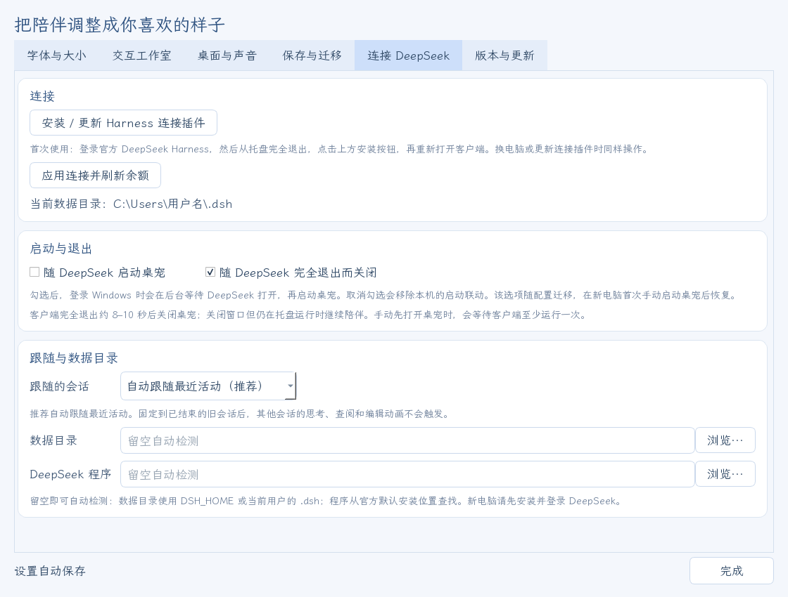
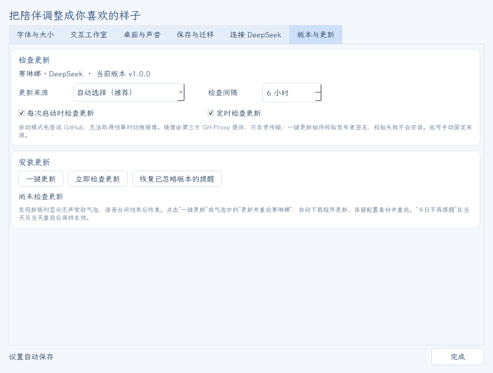
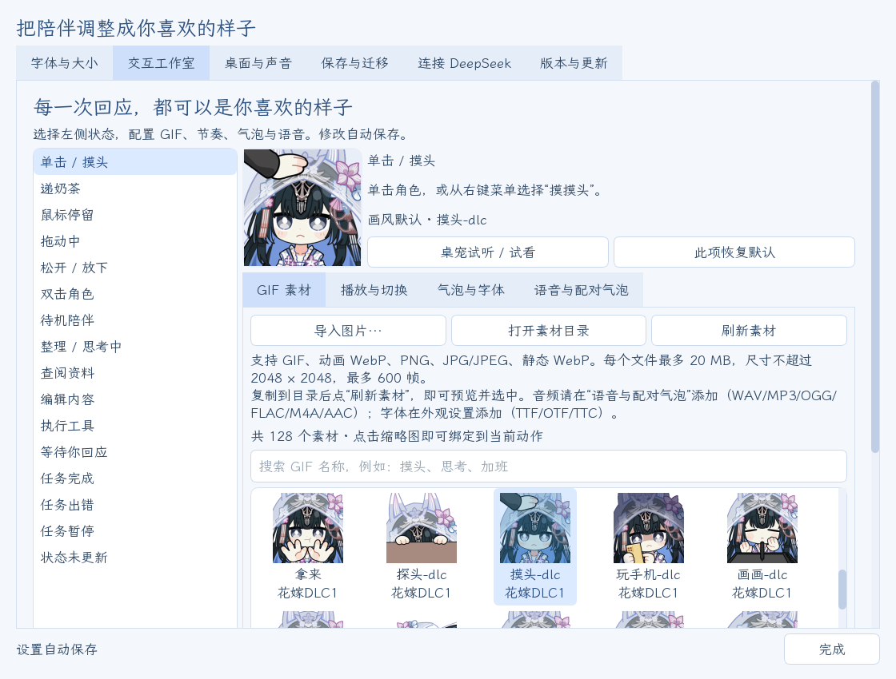
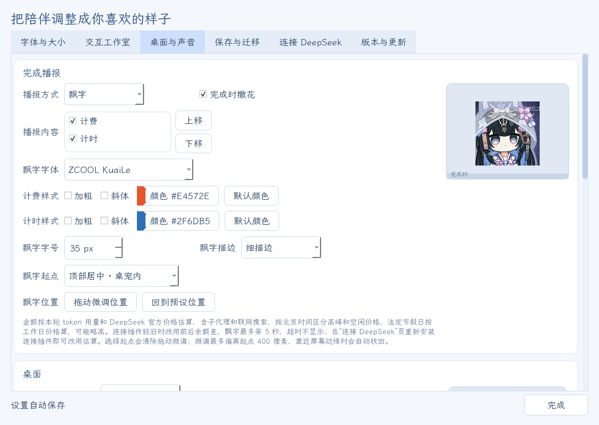

<!-- README language switch -->
[](README.md) [](README.en.md)

**v1.0.4**：休息提醒的“稍后再提醒”可以自己填等多久（1～240 分钟，默认 30），提醒卡片上的按钮按你填的分钟数显示。v1.0.3 补全了 33 条在素材导出时被截短的语音，已安装的桌宠更新后会自动换上完整版本，每句台词的结尾也不再被吞掉一小段。台词一旦开始就会完整说完，说话时点她、拖动她只换动作、不再打断；设置窗口打开即可看到全部预览。两套皮肤（花嫁 / 原皮）共 128 个表情，115 条赛琳娜语音按 16 种交互配好；完整包附带「一键部署」，连 Harness 连接插件一起装好，之后在桌宠内一键更新。

<!-- /README language switch -->

<div align="center">

# 赛琳娜 DeepSeek 桌宠

**《战双帕弥什》赛琳娜陪你使用 DeepSeek Harness：跟随任务切换表情，用她的声音回应你。**

[下载 Windows 版](https://github.com/Doya16/selena-deepseek-pet/releases/latest) · [使用说明](docs/USAGE.md) · [问题反馈](https://github.com/Doya16/selena-deepseek-pet/issues)


</div>

让赛琳娜陪你使用 **DeepSeek Harness 官方 Windows 客户端**：任务进行时换表情，完成后用语音和气泡回应，底部显示账户余额。

适用于 **Windows 10/11 x64**。完整包附带花嫁表情预设和共 128 个 GIF 的表情库、115 条赛琳娜语音（含字幕）、字体和 Harness 连接插件，无需安装 Python。也有 [Codex 版](https://github.com/Doya16/selena-codex-pet)，两版可以同时运行，分别保存设置。

## 安装方法

**系统要求**：Windows 10（1809 及以后）或 Windows 11，64 位；Windows 7 / 8 无法运行。需要先安装官方 **DeepSeek Harness** 桌面客户端，并登录、打开过一次。

1. 打开 [Releases](https://github.com/Doya16/selena-deepseek-pet/releases/latest)，下载 **Selena-DeepSeek-Windows-v1.0.4.zip**。
2. 解压：右键压缩包 →「全部解压缩」，或用 7-Zip / WinRAR 选「解压到 Selena-DeepSeek-Windows-v…\」（和压缩包同名的文件夹）。
   - 不要选「解压到当前文件夹」：压缩包里没有外层文件夹，文件会散在下载目录里。
   - 不要解压到 `C:\Program Files` 这类不能写入的位置，也不要在压缩软件里直接双击运行。
3. 进入解压出来的文件夹，双击 **一键部署.cmd**。它会：
   - 检查文件是否解压完整、文件夹能否写入；
   - 找到 DeepSeek Harness，提示你**完全退出** Harness：在托盘的 Harness 图标上右键 → 退出，回到部署窗口按回车（登录状态会保留），然后安装 Harness 连接插件；
   - 创建桌面和开始菜单快捷方式；
   - 启动赛琳娜。
4. 重新打开 Harness，开始任务。桌宠自动跟随最近活动的会话，同步状态和余额。

之后从桌面快捷方式启动即可。暂时不想退出 Harness 时，可以在提示处输入 `S` 跳过插件，之后再运行一次「一键部署.cmd」，或在 **设置 → 连接 DeepSeek → 安装 / 更新 Harness 连接插件** 中安装。无需额外填写 API Key。

**如果被系统或安全软件拦下：**

- 弹出「Windows 已保护你的电脑」时，点「更多信息」→「仍要运行」；弹出「打开文件 - 安全警告」时，点「运行」。程序没有购买商业代码签名，所以 Windows 会这样提示，并不是病毒。
- 360、火绒等安全软件如果拦截，请把这个文件夹加入信任区。全部源码公开在 GitHub：[github.com/Doya16/selena-deepseek-pet](https://github.com/Doya16/selena-deepseek-pet)；每个版本的发布页都附有 SHA256SUMS 校验文件，可以核对下载的文件是否完整、未被改动。

以后有新版本，桌宠会自己提示，点 **更新并重启赛琳娜** 即可一键更新，设置和素材都会保留（见下文「一键更新」）。

声音默认开启，音量为 10%。在「设置 → 桌面与声音」中调整或关闭。



## 表情

默认使用 **花嫁 · 希声时装** 表情包，16 种交互都有对应的花嫁表情。

表情库里还有原皮、社区包、圣诞和新年系列，加上花嫁一共 128 张。在 **设置 → 交互工作室** 里，可以给任意一种交互单独换成其中任意一张，也可以导入自己的图片。

## 一键更新

桌宠启动后会在后台检查新版本，默认每 6 小时检查一次。发现新版时，桌宠旁出现无声更新气泡；点击 **更新并重启赛琳娜**，即可完成下载、校验、安装和重启。

- 更新只下载程序文件，保留 GIF、语音、字幕、字体和全部个人设置。
- 更新清单由发布者离线密钥签名（Ed25519），签名不对就不会安装；无论经 GitHub 还是镜像下载都会校验。
- 下载中断不会修改现有程序；安装中断或新版启动失败，会恢复更新前的版本和设置。
- **更新来源**可选 **自动选择 / GitHub 官方源 / 镜像加速（中国大陆网络）**。镜像由第三方 [GH-Proxy](https://gh-proxy.com/docs/github-accelerator) 提供，只负责传输。
- 如果某次更新说明需要更新连接插件，按提示重新运行「一键部署.cmd」或在连接设置中重装即可。



详见 [更新与恢复](docs/UPDATES.md)。

## 功能

- **跟随任务**：思考、查阅、编辑、执行、等你回应、完成、报错和暂停使用不同表情。多个会话完成后分别排队提醒。
- **鼠标互动**：单击摸头、双击、悬停、拖动、放下、递奶茶，各有回应和语音。
- **赛琳娜的声音**：115 条语音来自岚音、幻奏、希声的机体语音和活动剧情配音，每条都配好字幕；同一动作多条语音随机抽取。
- **账户余额与本轮花费**：底部显示充值与赠送余额合计；任务结束后可显示本轮按 token 计算的花费。
- **自选素材**：每种交互单独选择 GIF 或图片；循环、速度、停留时间和下一状态均可调整；也可以导入自己的图片和语音。
- **陪伴**：完成时飘字显示用时和花费并撒花、贴边藏起、全屏隐藏、每日小结、喝水久坐提醒。
- **保存与迁移**：GIF、声音、气泡、字体和全部配置一起打包，带到另一台电脑。



**声音与托盘**：Windows 音量合成器显示「赛琳娜 · DeepSeek」，可单独调节音量。托盘提示为「赛琳娜 · DeepSeek · 点击唤醒/隐藏」，单击即可切换显示。



## 适用范围

- 面向官方 Harness 桌面客户端；网页版普通 DeepSeek 聊天不在连接范围。
- 连接插件名为 `dsh-selena-pet`，与其他桌宠的连接插件互不影响，可以同时安装。
- 关闭程序：右键 → **关闭赛琳娜**。

## 常见问题

**一键部署提示“在压缩包里直接运行”？** 先把整个 ZIP 解压到一个文件夹，再双击里面的「一键部署.cmd」。

**连接插件没装上？** 确认已从托盘完全退出 Harness（不是只关窗口），并且 Harness 至少打开过一次；然后再运行一次「一键部署.cmd」。

**表情没有跟随新任务？** 重新打开 Harness 后开始一个新任务；在「设置 → 连接 DeepSeek」选择「自动跟随最近活动」。

**遇到其他问题？** 到 [Issues](https://github.com/Doya16/selena-deepseek-pet/issues) 附上系统版本、Harness 版本、操作步骤和报错截图。

## 素材来源与致谢

表情包素材来源：**赛琳娜厨子 QQ 群 978621218**。感谢赛琳娜厨子们制作并分享这些表情包（原皮、花嫁、DLC、社区包、圣诞与新年系列）。

角色语音来自《战双帕弥什》赛琳娜（岚音、幻奏、希声）的机体语音与活动剧情配音。

角色、表情包图片与原版语音的权利归各自权利人所有（《战双帕弥什》© 库洛游戏）。本项目为同人作品，与官方无关。表情包仅供个人、非商业使用，请勿倒卖或用于付费分发。程序依赖及字体的许可不适用于角色素材；详见 [素材说明](assets/CREDITS.txt) 和 [第三方许可](THIRD_PARTY.txt)。

<details>
<summary>从源码运行</summary>

安装 Python 3.12，在项目目录执行：

```powershell
python -m venv .venv
.\.venv\Scripts\python.exe -m pip install -r requirements.txt
.\.venv\Scripts\python.exe -m selena_pet
```

源码入口：根目录的 **赛琳娜DeepSeek桌宠启动.vbs**，或上述命令。程序模块位于 `selena_pet/`；连接插件位于 `integrations/deepseek/`；构建、发布和快捷方式工具位于 `tools/`。

构建便携版：先运行 `.\.venv\Scripts\python.exe -m pip install -r tools/requirements-build.txt`，再运行 `.\.venv\Scripts\python.exe tools/build_portable.py`。输出在 `dist/赛琳娜DeepSeek桌宠/`。发布文件由 `tools/make_release.py` 生成，更新清单用 `tools/sign_update.py --key` 签名。

运行检查：`.\.venv\Scripts\python.exe -m unittest discover -s tests`；连接插件：在 `integrations/deepseek` 中运行 `node --test`。

</details>
